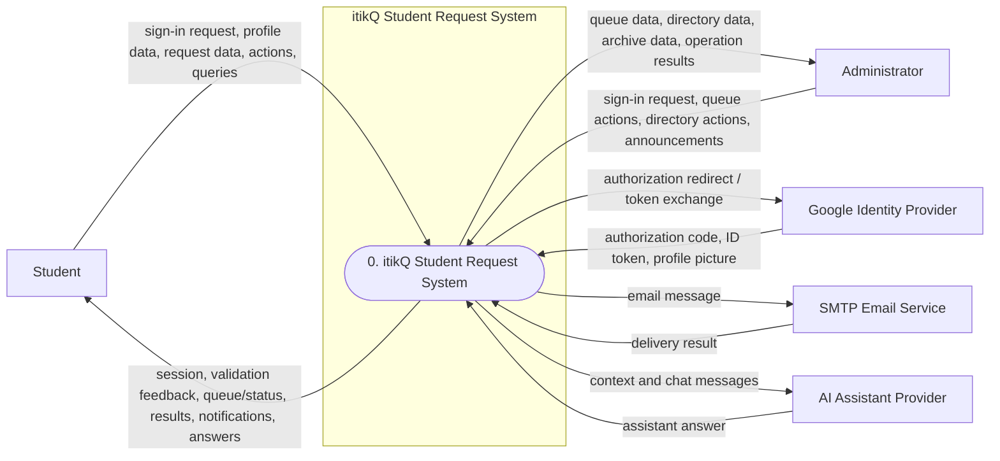
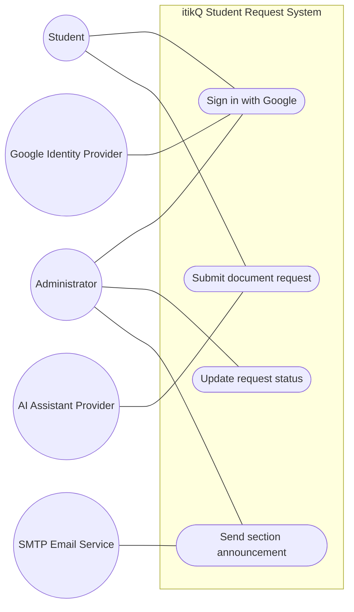
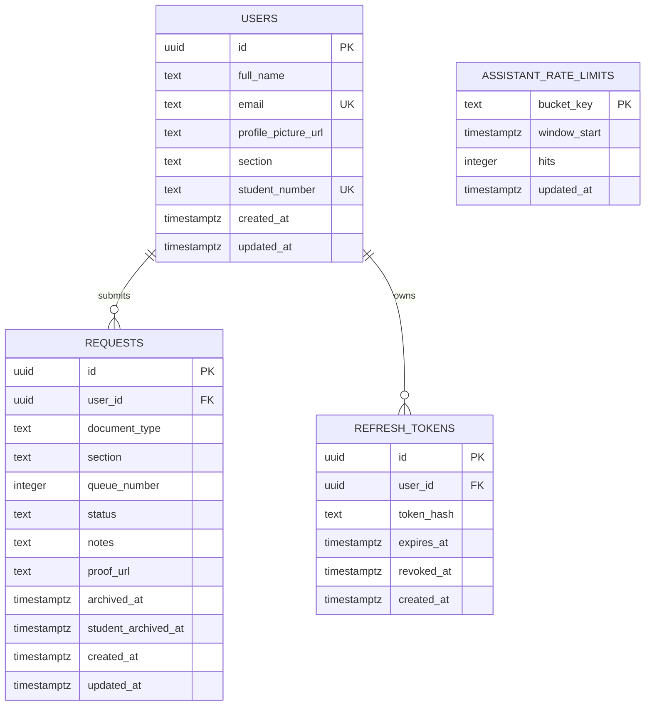

# AI Diagram Instructions — itikQ Student Request System

Use this document as the complete prompt for an AI diagramming assistant. The assistant must produce five diagrams for a Systems Analysis and Design (SAD) document:

1. Data Flow Diagram — Level 0 (Context Diagram)
2. Data Flow Diagram — Level 1
3. Use Case Diagram
4. System Flowchart
5. Entity-Relationship Diagram

---

## 1. Role and task

You are a systems analyst and diagramming specialist. Generate accurate, readable, academically presentable diagrams for the **itikQ Student Request System** of **Pateros Technological College**.

Do not design a different system. Do not add features that are not described here. Treat this document as the source of truth. If something is genuinely unspecified, mark it clearly as `ASSUMPTION:` instead of inventing it.

Produce all five diagrams, in the order listed above. For each diagram provide:

- A short title and one-sentence purpose.
- The diagram in an editable format (Mermaid preferred; PlantUML or draw.io XML acceptable where Mermaid cannot express the required notation).
- A legend explaining the symbols and labels used.
- A short assumptions/notes section, only when needed.
- A consistency check against the rules in Section 9.

If your environment can render images, export each diagram as a high-resolution PNG or SVG in addition to the editable source. Do not combine all five diagrams into one image.

---

## 2. Project snapshot

- **Product name:** itikQ
- **Institution:** Pateros Technological College (PTC)
- **System type:** Web-based student document request and registrar queue management system
- **Stack:** Next.js 16 App Router, React 19, TypeScript, Tailwind CSS, Supabase (Postgres, Storage, Realtime), Google OAuth 2.0, JWT sessions, Nodemailer SMTP, optional OpenAI-compatible AI assistant provider.
- **Primary users:** Students of Pateros Technological College.
- **Secondary users:** Registrar/school staff acting as administrators.
- **Purpose:** Let students request official school documents with minimal friction, receive a queue number, and track status; let staff review the queue, update statuses, manage student records, send announcements, and preserve completed queue cycles.

### High-level workflow

1. A student or administrator signs in with a PTC Google account.
2. The server verifies the Google identity and the allowed school domain.
3. The server finds or creates the user record and issues application session cookies.
4. Administrators are identified by the server-side `ADMIN_ACCOUNTS` environment variable and go directly to the admin dashboard.
5. Students who have not completed their profile are sent to onboarding; students with a complete profile go to the student dashboard.
6. Students submit document requests, receive a per-section queue number, and track status in real time.
7. Administrators review requests, change statuses, complete queue cycles, manage students, and send emails.
8. Completed and rejected requests can be archived by the administrator (queue cycle) and separately filed away by the student.

### Pages/routes that matter for the diagrams

- `/login` — Google sign-in
- `/onboarding` — student profile completion
- `/dashboard` — student or admin dashboard, depending on role
- `/request` — service selection
- `/request/[slug]` — request form for a selected service
- `/dashboard/archive` — student archive
- `/dashboard/help` — help center
- `/dashboard/admin/students` — admin student directory
- `/dashboard/admin/archive` — admin archive

Do not model implementation details such as React components, Server Action function names, or API endpoint paths as DFD processes. They are implementation mechanisms, not business processes.

---

## 3. Non-negotiable facts

The diagram assistant must not contradict any of these facts.

1. **Authentication is Google OAuth only.** There is no email/password login, no registration form, no Supabase Auth, and no argon2 password flow. The README's old auth boilerplate is outdated; the code is the source of truth.
2. **Only the school domain is allowed:** `paterostechnologicalcollege.edu.ph`. A Google account from another domain is rejected.
3. **Administrators are not a database role.** Admin status is derived at runtime from the server-side `ADMIN_ACCOUNTS` environment variable. There is no `admins` table and no `role` column.
4. **Administrators bypass student onboarding.** Students must have a section and student number before requesting. An administrator without those fields still goes directly to the admin dashboard.
5. **There are exactly six document services:** Certificate of Registration (COR), Transcript of Records (TOR), Certificate of Grades (COG), Grade Correction, Subject Request, and Others. "Others" requires an explanation in the notes. The service catalog is code-defined; there is no `services` table.
6. **Queue numbers are per section, not global.** Each section has its own active queue. A section's next queue number is the highest active queue number in that section plus one. Different sections can simultaneously have Queue 1.
7. **The request stores a snapshot of the student's section** at creation time. `requests.section` is a snapshot, not a foreign key to `users.section`.
8. **Request statuses are exactly:** `pending`, `processing`, `completed`, `rejected`. The database stores lowercase text. UI labels are Pending, Processing, Completed, Rejected.
9. **A student may have only one active request per document type.** "Active" means `archived_at IS NULL` and status `pending` or `processing`.
10. **Request limits:** maximum 5 requests per student per day, and a 60-second cooldown between requests. The server enforces both.
11. **Proof attachment rules:** optional; maximum 5 MB; allowed types are JPG, PNG, WEBP, GIF, and PDF. Notes are capped at 500 characters. "Others" cannot be submitted without notes.
12. **Students can edit or delete only their own pending, unarchived requests.** Processing, completed, and rejected requests cannot be edited or deleted by the student.
13. **Students can archive only completed or rejected requests.** Student archiving sets `student_archived_at`; it hides the request from the student's dashboard but does not remove it from the registrar's active queue. Students can restore a student-archived request.
14. **Administrators can change a request to any of the four statuses**, including reverting to a previous status. Status changes update `updated_at`.
15. **Status emails are sent only when status becomes `completed` or `rejected`.** Moves to `pending` or `processing`, and admin reverts, do not email the student. Email sending is skipped if SMTP is not configured.
16. **"Complete queue cycle" archives only completed and rejected requests.** It sets `archived_at` on those rows. Pending and processing requests stay active and keep their queue numbers. Nothing is deleted.
17. **Admin archive and student archive are separate.** `archived_at` is the registrar's queue-cycle archive. `student_archived_at` is the student's own filing-away action.
18. **Administrators can delete a student account.** This deletes the user row and their related request rows and refresh-token rows. An administrator cannot delete their own account, and admin accounts cannot be deleted through this function. The current code does not delete the student's storage files, so do not show storage deletion.
19. **Session behavior:** a short-lived JWT access token (5 minutes) and a long-lived refresh token (30 days) are stored in cookies. Only a SHA-256 hash of the refresh token is stored in the database. The proxy guards protected routes and refreshes expired sessions; refresh tokens are rotated when expired. Logout deletes the refresh-token record and clears both cookies.
20. **Supabase Realtime keeps dashboards live.** Both student and admin dashboards subscribe to changes on the `requests` table through the browser Supabase client. Students receive only their own rows; admins receive all request rows.
21. **Data storage:** Supabase Postgres stores `users`, `requests`, `refresh_tokens`, and `assistant_rate_limits`. Supabase Storage buckets `profile_pictures` and `request_proofs` store files. The buckets are public; the database stores only URLs.
22. **The AI assistant is read-only with respect to requests.** It builds context from the signed-in user's profile and requests, enforces rate limits stored in `assistant_rate_limits`, and calls an external OpenAI-compatible provider. It never submits, edits, approves, or rejects requests.
23. **Section announcements go only to verified students** — students with both a section and a student number. The admin can target one section or all verified students. Each recipient receives a personalized email.
24. **There is no online payment, document generation, document delivery, or claim-tracking workflow.** "Completed" means the document is ready to claim at the school; it does not mean the document was emailed or released online.
25. **`requests` does not store student name or email.** Those are derived by joining `users`. Do not draw `student_name` or `student_email` columns in the ERD.

---

## 4. Global notation and naming rules

Use these identifiers and labels consistently across all five diagrams.

### External entities / actors

| ID | Name | Type |
| --- | --- | --- |
| E1 | Student | Primary actor / external entity |
| E2 | Administrator | Primary actor / external entity (registrar or school staff) |
| E3 | Google Identity Provider | External system |
| E4 | SMTP Email Service | External system |
| E5 | AI Assistant Provider | External system |

Do not rename "Administrator" to "Admin User" or "Registrar" in some diagrams and "Administrator" in others. Use **Administrator** consistently; the description can say "registrar/school staff."

### Data stores (DFD Level 1 only)

| ID | Name | Physical form |
| --- | --- | --- |
| D1 | Users | Postgres table |
| D2 | Requests | Postgres table |
| D3 | Refresh Tokens | Postgres table |
| D4 | Assistant Rate Limits | Postgres table |
| D5 | Profile Pictures | Supabase Storage bucket |
| D6 | Request Proofs | Supabase Storage bucket |

### DFD processes (Level 1)

| ID | Name |
| --- | --- |
| P1.0 | Authenticate and Manage Session |
| P2.0 | Manage Student Profile |
| P3.0 | Submit Document Request |
| P4.0 | Track and Maintain Own Requests |
| P5.0 | Process Request Queue |
| P6.0 | Manage Student Directory |
| P7.0 | Send Section Announcements |
| P8.0 | Provide AI Assistant |

Use these exact process names unless a shorter label is necessary for readability; if shortened, keep the same meaning and include the full name in the legend.

### General rules

- DFD data flows must be **labeled with nouns or noun phrases** describing the data, not control signals.
- Do not put decision diamonds, yes/no branches, or status logic in a DFD. DFDs show data movement, not control flow.
- Use case names must be **verb + object** (for example, "Submit document request," not "Request form").
- Flowchart decisions must be phrased as questions and have labeled `Yes`/`No` branches.
- In the ERD, use **snake_case database column names**, not TypeScript camelCase names.
- Keep the same entity, actor, process, and data-store names in every diagram where they appear.
- Do not show implementation details such as Server Actions, route handlers, React hooks, SQL index names inside process bubbles, or cookie names inside DFD processes. Put technical details in notes.
- Prefer clarity over completeness. If a diagram becomes unreadable, split it into clearly labeled panels while keeping one logical diagram title.
- Do not use emojis, icons, or decorative clip art.

---

## 5. Diagram 1 — Data Flow Diagram Level 0 (Context Diagram)

### Purpose

Show itikQ as a single system and its data exchanges with the outside world.

### Required structure

- One process only: **`0. itikQ Student Request System`**.
- Place the process inside a system boundary labeled **itikQ Student Request System**.
- Place these external entities outside the boundary:
  - Student
  - Administrator
  - Google Identity Provider
  - SMTP Email Service
  - AI Assistant Provider
- Do **not** show any data stores at Level 0.
- Do not show internal processes at Level 0.
- Every arrow must have a label.

### Required data flows

| External entity | Data into the system | Data out of the system |
| --- | --- | --- |
| Student | Google sign-in request; authenticated requests carrying session cookies; profile details (course, year, section code, student number); document service selection, notes, and optional proof file; edit/delete/archive/restore actions; request-tracking queries; help-center and AI assistant questions | Sign-in redirect and session cookies; onboarding or validation feedback; dashboard data; queue number and request status; archive and action results; status email notifications; help content and AI assistant answers |
| Administrator | Google sign-in request; authenticated requests carrying session cookies; queue review/filter/search/sort selections; request status updates; complete-queue-cycle request; student directory actions; student account deletion request; announcement section, subject, and message | Admin dashboard data; active request queue and queue statistics; student directory data; archived queue data; status update and queue-cycle results; account deletion results; announcement delivery summary |
| Google Identity Provider | OAuth authorization code; verified ID token containing identity claims; Google profile picture | Authorization redirect / token-exchange request |
| SMTP Email Service | Delivery acknowledgment or delivery result | Request status notification email; section announcement email |
| AI Assistant Provider | Generated assistant answer | System prompt, student context, and chat messages |

### Constraints

- The context diagram must balance with DFD Level 1: every external entity and every high-level data flow shown here must also appear in Level 1, decomposed into the appropriate processes and data stores.
- Do not add a "Supabase" external entity. Supabase is an internal data store/technology, represented in Level 1 as data stores D1–D6.
- Do not show an "Admin" and a "Registrar" as separate entities. Use one Administrator entity.
- Do not show payment, document generation, or delivery entities.

### Suggested Mermaid shape mapping



Keep the actual labels readable; the sample above is a structural guide, not a requirement to use Mermaid exactly.

---

## 6. Diagram 2 — Data Flow Diagram Level 1

### Purpose

Decompose the context process into the major business processes and data stores of itikQ.

### Required external entities

Use exactly E1–E5 from the context diagram. Do not introduce a new external entity at Level 1.

### Required processes and data flows

#### P1.0 — Authenticate and Manage Session

**Inputs**
- Student or Administrator Google sign-in request.
- OAuth authorization code and verified ID token from Google.
- Google profile picture.
- Access/refresh cookies on later requests.
- Logout request.

**Processing**
- Verify the OAuth state value.
- Exchange the authorization code with Google.
- Verify the ID token and the school email domain.
- Find an existing user by email or create a new user.
- Download/store the Google profile picture if available.
- Determine whether the user is an administrator via `ADMIN_ACCOUNTS`.
- Issue a 5-minute access JWT and a 30-day refresh token; store only the refresh-token hash.
- On protected requests, verify the access token; refresh it when expired; rotate expired refresh tokens.
- On logout, delete the stored refresh-token record and clear cookies.

**Outputs**
- Session cookies for the browser.
- Authenticated user identity/context.
- Redirect to onboarding, student dashboard, or admin dashboard.
- Logout confirmation with cleared session.

**Data stores**
- `D1 Users` (read by email/id; create user; update profile picture URL).
- `D3 Refresh Tokens` (create, read, revoke, delete).
- `D5 Profile Pictures` (store downloaded Google image; return public URL).

**External entity**
- `E3 Google Identity Provider`.
- `E1 Student` and `E2 Administrator` for sign-in/logout initiation.

#### P2.0 — Manage Student Profile

**Inputs**
- Course code, year level, section code, student-number format choice, and student number.

**Processing**
- Validate the course, year, section code, student-number length, and standard ID pattern.
- For standard IDs, require the course embedded in the ID to match the entered course.
- Build the section string as `COURSE YEAR+SECTION` (for example, `BSIT 3H`).
- Save the section and student number to the user's profile.
- Reject duplicate student numbers.

**Outputs**
- Saved profile or a validation error.
- Redirect to the student dashboard on success.

**Data store**
- `D1 Users` (read and update).

**External entity**
- `E1 Student`.

#### P3.0 — Submit Document Request

**Inputs**
- Authenticated student identity.
- Selected document service title.
- Optional notes (required for "Others").
- Optional proof file.

**Processing**
- Confirm the user is a student, has a complete profile, and is not an administrator.
- Validate the selected service against the six-service catalog.
- Validate notes length and "Others" notes requirement.
- Validate proof size and MIME type.
- Reject a duplicate active request for the same document type.
- Enforce the 5-requests-per-day limit.
- Enforce the 60-second cooldown.
- Store the proof file if supplied.
- Compute the next queue number for the student's section from the active queue.
- Insert the request with `status = pending`, the section snapshot, and the queue number.
- Retry on a queue-number race using the partial unique index.

**Outputs**
- Request confirmation with queue number.
- Validation or submission error.

**Data stores**
- `D1 Users` (read profile/section/student number).
- `D2 Requests` (read active duplicate, today count, last request, max active queue number; write new request).
- `D6 Request Proofs` (write file; return public URL).

**External entity**
- `E1 Student`.

#### P4.0 — Track and Maintain Own Requests

**Inputs**
- Authenticated student identity.
- View/track request request.
- Edit notes/proof request.
- Delete request.
- Archive completed/rejected request.
- Restore student-archived request.
- Realtime request-change events from Supabase.

**Processing**
- Load the student's visible requests (excluding student-archived rows) and their student archive.
- Show queue number, status, document type, section, notes, timestamps, and proof URL.
- Allow edit/delete only for the student's own pending, unarchived requests.
- Allow archive only for completed/rejected requests.
- Allow restore only for student-archived requests.
- Reflect database changes live through Supabase Realtime.
- Keep admin archive state (`archived_at`) separate from student archive state (`student_archived_at`).

**Outputs**
- Request list, archive list, status/queue data, and action results.
- Live status updates on the dashboard.

**Data stores**
- `D2 Requests` (read, update notes/proof, set/clear `student_archived_at`, delete pending request).
- `D6 Request Proofs` (write replacement proof on edit).

**External entity**
- `E1 Student`.

#### P5.0 — Process Request Queue

**Inputs**
- Administrator identity.
- View/filter/search/sort request selections.
- New request status.
- Complete-queue-cycle request.
- Optional SMTP configuration.

**Processing**
- Confirm the user is an administrator.
- Load active requests (`archived_at IS NULL`) and archived requests.
- Group/filter by section and status; show queue statistics.
- Update a request's status and `updated_at`.
- Send a status email only when the new status is `completed` or `rejected`.
- Do not send email for `pending`, `processing`, or status reverts.
- On "Complete queue cycle," archive only completed/rejected requests by setting `archived_at`.
- Leave pending/processing requests active with their existing queue numbers.
- Never delete records during queue-cycle completion.
- Keep archived records grouped by section and completion date for the admin archive.

**Outputs**
- Active queue, request details, queue statistics, and archive data.
- Status update result.
- Status email to the student when applicable.
- Queue-cycle completion result.

**Data stores**
- `D2 Requests` (read active/archived rows; update status, `updated_at`, `archived_at`).

**External entities**
- `E2 Administrator`.
- `E4 SMTP Email Service` for status notifications.

#### P6.0 — Manage Student Directory

**Inputs**
- Administrator identity.
- Search/filter/view student selections.
- Delete student account request and confirmation.

**Processing**
- Confirm the user is an administrator.
- Load all non-admin users.
- Group students by year and section; support search by name, email, student number, or section.
- Prevent deletion of the administrator's own account.
- Prevent deletion of admin accounts through this function.
- Delete the student's request rows, refresh-token rows, and user row.

**Outputs**
- Student directory data.
- Account deletion result and updated directory.

**Data stores**
- `D1 Users` (read, delete).
- `D2 Requests` (delete all rows for the student).
- `D3 Refresh Tokens` (delete all rows for the student).

**External entity**
- `E2 Administrator`.

#### P7.0 — Send Section Announcements

**Inputs**
- Administrator identity.
- Target section (one section or "all verified students").
- Subject and message.

**Processing**
- Confirm the user is an administrator.
- Validate that a section, subject, and message are present.
- Load non-admin users.
- Resolve the target section(s).
- Include only students with both a section and a student number.
- Reject when no verified recipients exist.
- Require SMTP to be configured.
- Send one personalized email per recipient.
- Collect success/failure results.

**Outputs**
- Personalized section announcement emails.
- Delivery summary with sent and failed counts.

**Data stores**
- `D1 Users` (read student names, emails, sections, student numbers).

**External entities**
- `E2 Administrator`.
- `E4 SMTP Email Service`.

#### P8.0 — Provide AI Assistant

**Inputs**
- Authenticated user chat message/history.
- Assistant context request.

**Processing**
- Confirm the user is authenticated.
- Build context from the user's profile and own requests.
- Limit context to the user's active requests and a few archived requests.
- Trim message history and message length.
- Consume per-user and global rate-limit buckets.
- Send the system prompt, context, and history to the AI provider.
- Return the generated answer; never write to `requests`.

**Outputs**
- Assistant answer.
- Availability, rate-limit, or provider-error response.

**Data stores**
- `D1 Users` (read user context).
- `D2 Requests` (read user's requests only).
- `D4 Assistant Rate Limits` (read/write counters).

**External entity**
- `E5 AI Assistant Provider`.
- `E1 Student` as the primary user of the assistant. Administrators may technically open the same widget, but the assistant is described as a student-facing feature; do not create a separate admin assistant use case.

### DFD Level 1 balancing rules

- Every Level 0 external entity must remain visible at Level 1.
- Every Level 0 data flow must be traceable to one or more Level 1 flows.
- The Level 0 process `0. itikQ Student Request System` becomes P1.0–P8.0 at Level 1.
- Data stores D1–D6 exist only at Level 1 (and lower levels, if produced).
- Student data flows split across P1.0, P2.0, P3.0, P4.0, and P8.0.
- Administrator data flows split across P1.0, P5.0, P6.0, and P7.0.
- Google appears only in P1.0. SMTP appears in P5.0 and P7.0. The AI provider appears only in P8.0.
- Do not show Server Actions, route handlers, React state, or WebSocket channels as processes. They can appear only in notes if necessary.

### Recommended DFD Level 1 layout

Use a left-to-right layout:

```text
Student / Administrator / Google / SMTP / AI Provider
                    |
                    v
        P1.0 ... P8.0 process bubbles
                    |
                    v
        D1 ... D6 data stores
```

Keep related processes near their stores:
- P1.0 near D1, D3, D5.
- P2.0 near D1.
- P3.0 near D1, D2, D6.
- P4.0 near D2, D6.
- P5.0 near D2 and SMTP.
- P6.0 near D1, D2, D3.
- P7.0 near D1 and SMTP.
- P8.0 near D1, D2, D4, and the AI provider.

---

## 7. Diagram 3 — Use Case Diagram

### Purpose

Show the functional goals of students and administrators and the external systems that support those goals.

### System boundary

Draw a boundary labeled **itikQ Student Request System**. Place all use cases inside it and all actors outside it.

### Primary actors

- **Student**
- **Administrator**

### Secondary/supporting actors

- **Google Identity Provider** — supports sign-in.
- **SMTP Email Service** — supports status notifications and section announcements.
- **AI Assistant Provider** — supports the AI assistant.

Do not add "Supabase" or "Database" as an actor. Do not add a separate "Registrar" actor. Do not add a "System" actor.

### Required use cases

#### Shared

- **Sign in with Google**
- **Log out**

#### Student

- **Complete or update student profile**
- **View student dashboard**
- **Browse document services**
- **Submit document request**
- **Upload supporting proof** (optional extension of Submit document request)
- **Track request status**
- **Edit pending request**
- **Delete pending request**
- **Archive completed or rejected request**
- **Restore archived request**
- **View help center**
- **Use AI assistant**

#### Administrator

- **Review active request queue**
- **Update request status**
- **Complete queue cycle**
- **View archived queues**
- **View student directory**
- **Delete student account**
- **Send section announcement**

#### Internal/supporting use cases (only if the diagram remains readable)

- **Validate request eligibility** — included by Submit document request.
- **Assign per-section queue number** — included by Submit document request.
- **Verify school domain** — included by Sign in with Google.
- **Issue or refresh session** — included by Sign in with Google and protected actions.
- **Send status notification** — extends Update request status when the new status is completed or rejected.
- **Archive finished requests in queue cycle** — included by Complete queue cycle.
- **Resolve verified recipients** — included by Send section announcement.

### Relationships

Use these relationships accurately:

- `Student` — **Sign in with Google**
- `Administrator` — **Sign in with Google**
- `Google Identity Provider` — **Sign in with Google**
- `Student` — **Log out**
- `Administrator` — **Log out**

- `Student` — **Complete or update student profile**
- `Student` — **View student dashboard**
- `Student` — **Browse document services**
- `Student` — **Submit document request**
- `Student` — **Track request status**
- `Student` — **Edit pending request**
- `Student` — **Delete pending request**
- `Student` — **Archive completed or rejected request**
- `Student` — **Restore archived request**
- `Student` — **View help center**
- `Student` — **Use AI assistant**
- `AI Assistant Provider` — **Use AI assistant**

- `Administrator` — **Review active request queue**
- `Administrator` — **Update request status**
- `Administrator` — **Complete queue cycle**
- `Administrator` — **View archived queues**
- `Administrator` — **View student directory**
- `Administrator` — **Delete student account**
- `Administrator` — **Send section announcement**
- `SMTP Email Service` — **Send section announcement**

- **Submit document request** `<<include>>` **Validate request eligibility**
- **Submit document request** `<<include>>` **Assign per-section queue number**
- **Upload supporting proof** `<<extend>>` **Submit document request** (condition: the student attaches a proof file)
- **Sign in with Google** `<<include>>` **Verify school domain**
- **Sign in with Google** `<<include>>` **Issue or refresh session**
- **Complete queue cycle** `<<include>>` **Archive finished requests in queue cycle**
- **Send section announcement** `<<include>>` **Resolve verified recipients**
- **Send status notification** `<<extend>>` **Update request status** (condition: new status is `completed` or `rejected`)
- `SMTP Email Service` — **Send status notification**

### Constraints and notes

- Do not connect every use case to Google or to the database. Only connect secondary actors to the use cases they actually support.
- Do not draw a separate use case for every button or filter. Filtering, searching, and sorting are part of **Review active request queue**. If the grading rubric explicitly requires CRUD-level detail, add them as small child use cases and say so in the notes.
- All protected use cases require authentication. Show this as a single UML note attached to the system boundary or to the relevant actor/use-case group rather than drawing dozens of `<<include>>` arrows.
- Administrators require the server-side admin whitelist. Students require a completed profile for request-related use cases.
- Administrator use cases do not include submitting or editing student requests.
- Student use cases do not include managing other students or changing request statuses.
- "Complete queue cycle" is not the same as "Delete request." It archives only completed/rejected rows and preserves other active rows.
- "Archive completed or rejected request" is the student's own filing-away action; it is not the admin queue-cycle archive.
- Do not show email/password login, password reset, registration, or Supabase Auth.

### Suggested Mermaid shape mapping



The sample is illustrative only; generate the complete use case diagram with all required use cases and relationships. If Mermaid renders actor associations poorly, use PlantUML with `left to right direction`.

---

## 8. Diagram 4 — System Flowchart

### Purpose

Show the end-to-end operational flow of itikQ, including role branching, the student request lifecycle, administrator operations, external service calls, and major error paths.

### Required lanes

Use swimlanes/subgraphs for:

1. **User** — Student or Administrator.
2. **itikQ Application** — authentication guard, server actions, validation, role checks, request lifecycle logic.
3. **Supabase** — Postgres data and file storage.
4. **External Services** — Google, SMTP, AI provider.

If a five-lane version with separate Student and Administrator lanes is more readable, use five lanes. The important requirement is that role branching is explicit.

### Main flow

1. **Start** — User opens itikQ.
2. **Session check** — Application verifies the access token in the request cookie.
3. If the access token is valid, continue.
4. If the access token is expired but a refresh token exists:
   - Navigation requests are sent to the refresh flow.
   - Mutation requests refresh inline.
   - If refresh succeeds, issue new cookies and continue.
   - If refresh fails, clear cookies and go to login.
5. If no valid session exists, show **Login**.
6. **Sign in with Google** — User authenticates with Google.
7. **Domain check** — Is the email domain `paterostechnologicalcollege.edu.ph`?
   - No → show access denied / return to login.
   - Yes → find or create the user record; store the profile picture if available; issue session cookies.
8. **Role check** — Is the user in `ADMIN_ACCOUNTS`?
   - Yes → go to **Admin dashboard**.
   - No → continue as student.
9. **Student profile check** — Does the student have a section and student number?
   - No → **Onboarding**: enter course, year, section code, student number; validate; save profile; go to student dashboard.
   - Yes → go to **Student dashboard**.

### Student branch

From the student dashboard, the student can choose:

- **Start a request**
- **Track or maintain requests**
- **View help center**
- **Use AI assistant**
- **Log out**

#### Start a request

1. Browse the six document services.
2. Select a service.
3. Enter notes (required for "Others") and optionally attach a proof file.
4. Submit.
5. Application validates:
   - Student is not an administrator.
   - Profile has a section.
   - Document type is valid.
   - "Others" has notes.
   - Proof is within 5 MB and an allowed type.
   - No active request exists for the same document type.
   - Daily limit of 5 has not been reached.
   - At least 60 seconds have passed since the last request.
6. If validation fails → show the error and return to the form/dashboard.
7. If validation passes:
   - Upload the proof if present.
   - Determine the next queue number for the student's section.
   - Insert the request with `status = pending`.
   - Show the queue number and confirmation.
8. Return to the student dashboard.

#### Track or maintain requests

1. Load the student's visible requests and student archive.
2. Apply live updates from Supabase Realtime.
3. Student chooses an action:
   - **Edit** → allowed only for a pending, unarchived request; update notes/proof.
   - **Delete** → allowed only for a pending, unarchived request; confirm; delete.
   - **Archive** → allowed only for completed/rejected requests; set `student_archived_at`.
   - **Restore** → clear `student_archived_at` for a student-archived request.
   - **View** → show queue number, status, section, notes, timestamps, and proof.
4. Application checks ownership and status; rejects invalid actions.
5. Save the change; return the result; the dashboard updates live.

#### Help or AI assistant

- **Help center**: show FAQ categories and search results.
- **AI assistant**:
  1. Load the student's context.
  2. Validate authentication and rate limits.
  3. Send the system prompt, context, and recent messages to the AI provider.
  4. Return the answer.
  5. On rate limit/provider failure, show an error message.

#### Log out

1. Delete the refresh-token record.
2. Clear both session cookies.
3. Return to login.

### Administrator branch

From the admin dashboard, the administrator can choose:

- **Review active request queue**
- **Update request status**
- **Complete queue cycle**
- **View archived queues**
- **View student directory**
- **Delete student account**
- **Send section announcement**
- **Log out**

#### Review active request queue

1. Load active requests (`archived_at IS NULL`).
2. Apply Supabase Realtime updates.
3. Filter/search/sort by section, status, or other available criteria.
4. Show request details, queue statistics, and student identity.

#### Update request status

1. Select a request and a new status: `pending`, `processing`, `completed`, or `rejected`.
2. Application verifies the user is an administrator.
3. Save the status and `updated_at`.
4. If the new status is `completed` or `rejected`, send a status email when SMTP is configured.
5. Update the dashboard live.
6. Allow reverting to a previous status; a revert does not send email.

#### Complete queue cycle

1. Administrator confirms the action.
2. Application archives only completed/rejected requests by setting `archived_at`.
3. Pending/processing requests remain active and keep their queue numbers.
4. No records are deleted.
5. The archive becomes available under the admin archive view.

#### View archived queues

1. Load archived requests (`archived_at IS NOT NULL`).
2. Group by section and completion date.
3. Display preserved records for review.

#### Manage student directory

1. Load non-admin students.
2. Group by year and section; search/view profile details.
3. If deleting:
   - Confirm the destructive action.
   - Prevent self-deletion.
   - Prevent deletion of admin accounts.
   - Delete the student's requests, refresh tokens, and user row.
4. Refresh the directory.

#### Send section announcement

1. Choose one section or "all verified students."
2. Enter subject and message.
3. Application validates the input and resolves recipients with both a section and student number.
4. If SMTP is not configured, show an error.
5. Send one personalized email per recipient.
6. Show a delivery summary with success/failure counts.

#### Log out

Same as the student logout flow.

### Request status lifecycle to include as a subgraph or note

```text
pending ──────────────> processing ──────────────> completed
   │                         │                        │
   │                         └────────> rejected <────┘
   │
   ├── student may edit/delete while pending
   │
   └── completed/rejected may be archived by student or admin
       pending/processing remain active during admin queue-cycle completion
```

Clarifications:

- Administrators may move a request between any of the four statuses, including reverting.
- Students cannot change status; they only submit, edit/delete pending requests, and archive/restore finished requests.
- "Completed" means ready to claim at school, not delivered online.
- Admin queue-cycle archive and student archive are separate.

### Flowchart rules

- Use an oval for Start/End, a parallelogram for input/output, a rectangle for a process, a diamond for a decision, and a cylinder for a data store/document.
- Label every decision branch `Yes` or `No` (or with a meaningful condition such as `Invalid proof`).
- Show error paths; do not draw only the happy path.
- Do not show React components, CSS, or Server Action names.
- If the chart is too dense for one readable canvas, split it into three clearly labeled panels — **Authentication and Onboarding**, **Student Request Lifecycle**, and **Administrator Operations** — while retaining one overall system flowchart title and a small legend connecting the panels.
- Keep the direction top-to-bottom unless a left-to-right layout is clearer.

---

## 9. Diagram 5 — Entity-Relationship Diagram

### Purpose

Show the persistent relational data model of itikQ and the relationships among its tables.

### Required entities

Use exactly these four relational tables. Do not add tables that do not exist in `database/schema.sql`.

#### USERS

| Column | Type | Constraints / notes |
| --- | --- | --- |
| `id` | UUID | Primary key; default `gen_random_uuid()` |
| `full_name` | TEXT | Not null |
| `email` | TEXT | Not null; unique |
| `profile_picture_url` | TEXT | Nullable; public URL in the `profile_pictures` bucket |
| `section` | TEXT | Nullable; student's class section, e.g. `BSIT 3H` |
| `student_number` | TEXT | Nullable; unique |
| `created_at` | TIMESTAMPTZ | Not null; default `now()` |
| `updated_at` | TIMESTAMPTZ | Not null; default `now()` |

#### REQUESTS

| Column | Type | Constraints / notes |
| --- | --- | --- |
| `id` | UUID | Primary key; default `gen_random_uuid()` |
| `user_id` | UUID | Not null; foreign key → `users.id`; `ON DELETE CASCADE` |
| `document_type` | TEXT | Not null; one of the six service titles |
| `section` | TEXT | Nullable; snapshot of the student's section at creation |
| `queue_number` | INTEGER | Not null; per-section active queue number |
| `status` | TEXT | Not null; default `pending`; app-enforced values: `pending`, `processing`, `completed`, `rejected` |
| `notes` | TEXT | Nullable; maximum 500 characters in the app |
| `proof_url` | TEXT | Nullable; public URL in the `request_proofs` bucket |
| `archived_at` | TIMESTAMPTZ | Nullable; set by the admin queue-cycle archive |
| `student_archived_at` | TIMESTAMPTZ | Nullable; set when the student files the request away |
| `created_at` | TIMESTAMPTZ | Not null; default `now()` |
| `updated_at` | TIMESTAMPTZ | Not null; default `now()` |

#### REFRESH_TOKENS

| Column | Type | Constraints / notes |
| --- | --- | --- |
| `id` | UUID | Primary key; default `gen_random_uuid()` |
| `user_id` | UUID | Not null; foreign key → `users.id`; `ON DELETE CASCADE` |
| `token_hash` | TEXT | Not null; SHA-256 hash of the refresh token; raw token is never stored |
| `expires_at` | TIMESTAMPTZ | Not null; 30 days after issue |
| `revoked_at` | TIMESTAMPTZ | Nullable; set when the token is revoked |
| `created_at` | TIMESTAMPTZ | Not null; default `now()` |

#### ASSISTANT_RATE_LIMITS

| Column | Type | Constraints / notes |
| --- | --- | --- |
| `bucket_key` | TEXT | Primary key; e.g. `assistant:user:<id>:minute` or `assistant:global:day` |
| `window_start` | TIMESTAMPTZ | Not null; default `now()` |
| `hits` | INTEGER | Not null; default `0` |
| `updated_at` | TIMESTAMPTZ | Not null; default `now()` |

### Relationships

```text
USERS ||--o{ REQUESTS : "submits"
USERS ||--o{ REFRESH_TOKENS : "owns"
```

- One user can submit zero or many requests.
- Each request belongs to exactly one user.
- One user can have zero or many refresh tokens.
- Each refresh token belongs to exactly one user.
- Deleting a user cascades to that user's requests and refresh tokens.
- `ASSISTANT_RATE_LIMITS` has no foreign key and no relationship line. It is a standalone rate-limit table keyed by text bucket names.

### Critical ERD constraints and notes

- **Do not draw a relationship from `requests.section` to `users.section`.** It is a denormalized snapshot, not a foreign key.
- **Do not draw a `document_types` or `services` table.** The six services are a code-defined catalog, not a database table.
- **Do not draw an `admins` table or a `role` column.** Administrator status is derived from the `ADMIN_ACCOUNTS` environment variable.
- **Do not draw `student_name` or `student_email` in `requests`.** They are obtained by joining `users`.
- **Queue uniqueness is partial and per section:** the unique index `requests_active_section_queue_uq` covers `(section, queue_number)` only where `archived_at IS NULL`. State this in a note; do not draw a simple global unique constraint on `queue_number`.
- **Status is text in the database**, with the four allowed values enforced by application code, not by a database enum or check constraint. State this in a note.
- **`student_number` is nullable but unique when present.**
- **`email` is unique.**
- **`profile_picture_url` and `proof_url` store public URLs, not binary files.**
- **Supabase Storage buckets are not relational tables.** Add a note outside the ERD:
  - `profile_pictures` stores public profile images.
  - `request_proofs` stores public proof files.
  - The database stores only their public URLs in `users.profile_picture_url` and `requests.proof_url`.
- **`assistant_rate_limits` is standalone.** Do not invent a `user_id` foreign key even though bucket keys contain user IDs.
- The `@supabase/supabase-js` service-role client is used by the server; the browser uses the anon key only for Realtime reads. This is an implementation note, not an ERD relationship.

### ERD presentation

- Use crow's-foot notation.
- Show primary keys and foreign keys explicitly.
- Show cardinality labels on both ends of each relationship.
- Use snake_case column names.
- Group the four tables clearly; place `ASSISTANT_RATE_LIMITS` apart with a note that it has no relationships.
- Add a separate "Storage (not relational)" note for the two buckets.
- If using Mermaid `erDiagram`, include the key fields and add the omitted constraints in the legend/notes.

Suggested Mermaid structure:



---

## 10. Cross-diagram consistency checklist

Before returning the final output, verify all of the following:

- [ ] Exactly five diagrams are delivered: DFD Level 0, DFD Level 1, Use Case Diagram, System Flowchart, and ER Diagram.
- [ ] DFD Level 0 has exactly one process and no data stores.
- [ ] DFD Level 1 uses P1.0–P8.0 and D1–D6 consistently.
- [ ] Every external entity from Level 0 appears in Level 1.
- [ ] Every Level 0 data flow is traceable to Level 1.
- [ ] DFD arrows are labeled data flows, not control signals.
- [ ] DFDs contain no decision diamonds, yes/no branches, or API endpoints.
- [ ] Use case names are verb + object.
- [ ] Student and Administrator are the only primary human actors.
- [ ] Google, SMTP, and the AI provider are secondary actors only where they support a use case.
- [ ] The use case diagram does not imply that administrators submit student requests or that students manage request statuses.
- [ ] The system flowchart shows both the happy path and the major error paths.
- [ ] The flowchart includes role branching, profile completion, request submission validation, request maintenance, admin status updates, queue-cycle completion, student directory deletion, announcements, and logout.
- [ ] The flowchart distinguishes `archived_at` (admin queue cycle) from `student_archived_at` (student filing).
- [ ] The ERD contains only `users`, `requests`, `refresh_tokens`, and `assistant_rate_limits` as tables.
- [ ] The ERD uses snake_case column names and shows PK/FK/cardinality.
- [ ] The ERD does not show `student_name`, `student_email`, a `role` column, an `admins` table, or a `services` table.
- [ ] The ERD notes the partial per-section queue-number uniqueness rule.
- [ ] The ERD notes that status is app-enforced text, not a database enum.
- [ ] The ERD treats storage buckets as notes, not relational entities.
- [ ] No diagram shows email/password login, password reset, registration, Supabase Auth, or argon2.
- [ ] No diagram shows payment, document generation, online document delivery, or claim tracking.
- [ ] Status values are lowercase in data-model/flow labels: `pending`, `processing`, `completed`, `rejected`.
- [ ] Queue numbers are described as per-section, not global.
- [ ] "Complete queue cycle" is described as archiving only completed/rejected requests, never deleting them.
- [ ] Emails are described as sent only for `completed` and `rejected` status changes.
- [ ] The assistant is described as read-only for requests and subject to rate limits.
- [ ] All labels are consistent across the five diagrams.

---

## 11. Output format

Return the response in this order:

1. **Project-modeling summary** — no more than 8 bullets summarizing the system boundary, actors, data stores, and main workflows.
2. **Diagram 1 — DFD Level 0** — title, purpose, Mermaid/PlantUML source, legend, assumptions.
3. **Diagram 2 — DFD Level 1** — title, purpose, Mermaid/PlantUML source, legend, assumptions.
4. **Diagram 3 — Use Case Diagram** — title, purpose, Mermaid/PlantUML source, legend, assumptions.
5. **Diagram 4 — System Flowchart** — title, purpose, Mermaid source, legend, assumptions.
6. **Diagram 5 — ER Diagram** — title, purpose, Mermaid source, legend, assumptions.
7. **Consistency checklist results** — mark each item pass/fail and briefly explain any deliberate deviation.
8. **Open questions/assumptions** — only genuinely unspecified items; otherwise say "None."

Formatting requirements:

- Put each diagram in its own fenced code block.
- Use `flowchart LR` for DFDs, `left to right direction` for the use case diagram, `flowchart TD` for the system flowchart, and `erDiagram` for the ERD.
- Quote labels that contain spaces or punctuation.
- Avoid node IDs that contain spaces; use IDs such as `E1`, `P1_0`, `D1`, `UC_SIGN_IN`.
- Keep node labels short enough to read at normal zoom.
- Do not output one giant combined diagram.
- If Mermaid cannot faithfully represent a required notation (especially DFD data stores or ERD constraints), say so and provide PlantUML or draw.io XML as an alternate rather than silently changing the notation.
- If rendering is available, render each diagram and confirm it is legible at 100% zoom.

---

## 12. Source-of-truth files in the repository

Use these files if you have repository access and need to verify a detail:

- `database/schema.sql` — authoritative database schema, constraints, indexes, RLS, Realtime setup, rate-limit function.
- `database/student-archive.sql` — student archive column and index.
- `database/assistant-rate-limit.sql` — standalone assistant rate-limit table.
- `src/domain/user.ts` — user domain shape.
- `src/domain/request.ts` — request statuses and request domain shape.
- `src/domain/services.ts` — six-service catalog.
- `src/application/use-cases/google-login.ts` — Google login, domain restriction, user creation, token issue.
- `src/infrastructure/auth/google-oauth.service.ts` — Google ID-token verification.
- `src/infrastructure/auth/jose.token.service.ts` — access-token signing/verification.
- `src/infrastructure/auth/refresh-token.ts` — refresh-token generation and hashing.
- `src/infrastructure/auth/admin-accounts.ts` — `ADMIN_ACCOUNTS` whitelist.
- `src/server/session.ts` — session-cookie helpers.
- `src/server/refresh-session.ts` — refresh validation and rotation.
- `proxy.ts` — route protection, refresh handoff, auth rate limiting.
- `app/api/auth/google/callback/route.ts` — OAuth callback and cookie issuance.
- `app/api/auth/refresh/route.ts` — refresh endpoint.
- `app/actions/profile.ts` — student profile validation and save.
- `app/actions/requests.ts` — request submission, limits, status updates, archive/restore, queue-cycle completion, status emails.
- `app/actions/users.ts` — admin student-account deletion.
- `app/actions/mail.ts` — section announcements.
- `src/infrastructure/supabase/request-repository.supabase.ts` — request persistence and queue assignment.
- `src/infrastructure/supabase/user-repository.supabase.ts` — user persistence.
- `src/infrastructure/supabase/refresh-token-repository.supabase.ts` — refresh-token persistence.
- `src/infrastructure/supabase/request-proof-storage.ts` — proof upload bucket.
- `src/infrastructure/supabase/profile-picture-storage.ts` — profile-picture bucket.
- `src/infrastructure/mail/templates.ts` — status and announcement email templates.
- `app/api/assistant/chat/route.ts` — assistant rate limits and provider call.
- `app/api/assistant/context/route.ts` — assistant context endpoint.
- `src/server/assistant-context.ts` — context construction.
- `app/dashboard/page.tsx` — role-based dashboard routing.
- `app/dashboard/student/dashboard.tsx` — student dashboard behavior.
- `app/dashboard/admin/dashboard.tsx` — admin queue behavior.
- `app/dashboard/admin/queue-cycle-panel.tsx` — queue-cycle completion UX.
- `app/dashboard/admin/students-panel.tsx` — student directory and deletion UX.
- `app/dashboard/admin/archive-panel.tsx` — admin archive grouping.
- `app/dashboard/archive/student-archive-panel.tsx` — student archive restore UX.
- `app/dashboard/lib/use-realtime-requests.ts` — Realtime subscription behavior.
- `PRODUCT.md` — product context and users.
- `README.md` — setup notes only; its old auth boilerplate is not authoritative.

---

## 13. Final instruction

Generate the five diagrams now, in the order specified. Use the exact facts, actors, process names, data stores, statuses, and relationships in this document. Do not ask clarifying questions unless a critical fact is missing; mark any genuine gap as `ASSUMPTION:`. Prioritize correctness and readability over decorative detail. Begin with **Diagram 1 — Data Flow Diagram Level 0**.
